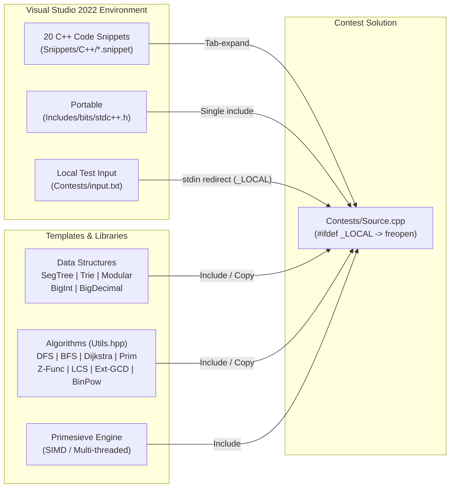

# Competitive Programming Contests — C++20 Algorithms, Data Structures & VS Snippets


-5C2D91?logo=visualstudio&logoColor=white)


A comprehensive C++20 competitive programming repository combining ready-to-use **data structures**, **graph/string/number-theory algorithms**, **arbitrary-precision arithmetic**, an **MSVC-compatible `<bits/stdc++.h>`**, an embedded **SIMD-accelerated `primesieve`** library, and **20 Visual Studio C++ code snippets** designed for rapid problem solving on Codeforces, AtCoder, LeetCode, and ICPC contests.

---

## Table of Contents

- [Overview & Contest Workflow](#overview--contest-workflow)
- [Data Structures & Algebraic Types](#data-structures--algebraic-types)
  - [1. Segment Tree (`SegTree.h`)](#1-segment-tree-segtreeh)
  - [2. Prefix Tree / Trie (`Trie.hpp`)](#2-prefix-tree--trie-triehpp)
  - [3. Modular Arithmetic Ring (`Modular.cpp`)](#3-modular-arithmetic-ring-modularcpp)
  - [4. Arbitrary-Precision Integer (`BigInt.hpp`)](#4-arbitrary-precision-integer-biginthpp)
  - [5. Arbitrary-Precision Decimal (`BigDecimal.hpp`)](#5-arbitrary-precision-decimal-bigdecimalhpp)
- [Algorithms & Utility Library](#algorithms--utility-library)
  - [Graph Algorithms (`Utils.hpp`)](#graph-algorithms-utilshpp)
  - [Strings, Dynamic Programming & Arrays (`Utils.hpp`)](#strings-dynamic-programming--arrays-utilshpp)
  - [Number Theory & Prime Sieving (`Utils.hpp` & `Primesieve/`)](#number-theory--prime-sieving-utilshpp--primesieve)
  - [Win32 Clipboard & Input Automation (`Utils.hpp` & `InputSimulator.hpp`)](#win32-clipboard--input-automation-utilshpp--inputsimulatorhpp)
- [Contest Entry Template (`Source.cpp`)](#contest-entry-template-sourcecpp)
- [Visual Studio C++ Code Snippets (`Snippets/C++/`)](#visual-studio-c-code-snippets-snippetsc)
  - [Algorithmic Snippets](#algorithmic-snippets)
  - [I/O & Boilerplate Snippets](#io--boilerplate-snippets)
  - [How to Import Snippets into Visual Studio](#how-to-import-snippets-into-visual-studio)
- [Project Structure](#project-structure)
- [Getting Started](#getting-started)
- [License](#license)

---

## Overview & Contest Workflow

When competing in timed programming contests, speed and reliability depend on having battle-tested templates and zero-friction local testing. This repository provides both a **Visual Studio C++20 sandbox project** and a **library of standalone headers and IDE snippets**:



### Key Highlights
- **Automatic Local Input Redirection (`_LOCAL`)**: Both `Debug` and `Release` Visual Studio configurations define `_LOCAL`. Inside `Source.cpp`, `#ifdef _LOCAL` automatically redirects `stdin` to `Contests/input.txt` via `freopen("input.txt", "r", stdin)`. Submitting `Source.cpp` directly to an online judge ignores the block without requiring manual edits.
- **MSVC `<bits/stdc++.h>` Portability**: Includes a custom `Includes/bits/stdc++.h` header wired into the project's Additional Include Directories so GCC-style `#include <bits/stdc++.h>` works natively in Visual Studio.
- **Hardware-Accelerated Optimization**: Uses `#pragma optimize("gt", on)` in `Utils.hpp` and includes the full `primesieve` engine with AVX-512, SSE2, and ARM NEON/SVE intrinsics.

---

## Data Structures & Algebraic Types

### 1. Segment Tree (`SegTree.h`)

A 1D power-of-two padded **Segment Tree** (`SegTree`) supporting point updates and half-open range sum queries $[l, r)$ using C++20 `std::midpoint`.

| Method | Signature | Time Complexity | Space Complexity | Description |
| :--- | :--- | :---: | :---: | :--- |
| Constructor | `SegTree(int n)` | $O(N)$ | $O(N)$ | Pads size to the next power of two and zeroes the tree. |
| Constructor | `SegTree(const std::vector<int>& v)` | $O(N)$ | $O(N)$ | Builds the segment tree bottom-up from an initial array in linear time. |
| Point Update | `void Set(int i, int v)` | $O(\log N)$ | $O(\log N)$ | Sets `a[i] = v` and updates ancestor sums along the root-to-leaf path. |
| Range Sum | `long long Sum(int l, int r)` | $O(\log N)$ | $O(\log N)$ | Returns the sum of elements in the half-open interval $[l, r)$. |

```cpp
#include "SegTree.h"

std::vector<int> a = {1, 3, 5, 7, 9, 11};
SegTree st(a);

long long s1 = st.Sum(1, 4); // Sum on [1, 4) -> 3 + 5 + 7 = 15
st.Set(2, 10);               // Update index 2 to 10
long long s2 = st.Sum(1, 4); // Sum on [1, 4) -> 3 + 10 + 7 = 20
```

---

### 2. Prefix Tree / Trie (`Trie.hpp`)

A 26-way lowercase English alphabet **Trie** (`Trie`) for fast dictionary lookups, prefix queries, recursive word deletion, and lexicographical traversal.

| Method | Signature | Time Complexity | Description |
| :--- | :--- | :---: | :--- |
| `insert` | `void insert(const std::string& word)` | $O(\|S\|)$ | Inserts a lowercase word into the trie. |
| `contains` | `bool contains(const std::string& word)` | $O(\|S\|)$ | Checks whether the exact word exists (`isEndOfWord == true`). |
| `startsWith` | `bool startsWith(const std::string& prefix)` | $O(\|P\|)$ | Checks whether any word in the trie has the given prefix. |
| `deleteWord` | `bool deleteWord(const std::string& word)` | $O(\|S\|)$ | Unmarks the word and recursively prunes unused trie nodes. |
| `print` | `void print() const` | $O(\text{total chars})$ | Prints all stored words in lexicographical order. |

---

### 3. Modular Arithmetic Ring (`Modular.cpp`)

A Tourist-style generic **`Modular<T>`** template that encapsulates modular arithmetic in $\mathbb{Z}/m\mathbb{Z}$, preventing integer overflow bugs in combinatorics, number theory, and DP problems.

- **Compile-Time or Dynamic Modulus**:
  - Fixed compile-time modulus (default `MOD = 998244353`) via `using Mint = Modular<std::integral_constant<int, MOD>>;`
  - Runtime variable modulus via `using Mint = Modular<VarMod>;`
- **Capabilities**:
  - Extended Euclidean modular inverse (`inverse(a, m)`) in $O(\log m)$.
  - Fast 64-bit modular multiplication (including a 32-bit `long double` fallback for platforms without native 64-bit fast mod).
  - Full operator overloading: `+`, `-`, `*`, `/`, `+=`, `-=`, `*=`, `/=`, `++`, `--`, `==`, `!=`, `<`, `<<`, `>>`.
  - Generic `power(Mint a, B b)` for $O(\log b)$ modular exponentiation.

```cpp
constexpr int MOD = 998244353;
using Mint = Modular<std::integral_constant<int, MOD>>;

Mint ways = Mint(2);
Mint ans = power(ways, 1000000) / Mint(3); // Computes (2^1000000 * 3^-1) mod 998244353
std::cout << ans << '\n';
```

---

### 4. Arbitrary-Precision Integer (`BigInt.hpp`)

A self-contained signed arbitrary-precision integer class (`BigInt`) for problems requiring numbers beyond 64-bit `unsigned long long` without external GMP dependencies.

- **Arithmetic & Relational Operators**: `+`, `-`, `*`, `/`, `%`, `+=`, `-=`, `*=`, `/=`, `%=`, `++`, `--`, `==`, `!=`, `<`, `<=`, `>`, `>=`.
- **Mathematical Functions**:
  - `pow(base, exp)` — Exponentiation with `BigInt`, `long long`, or `int` exponents.
  - `sqrt(n)` — Integer square root via Newton-Raphson iteration.
  - `gcd(a, b)` & `lcm(a, b)` — Arbitrary-precision Greatest Common Divisor and Least Common Multiple.
  - `Factorial(n)` — Computes $n!$ as a `BigInt`.
  - `big_random(num_digits)` — Generates a random `BigInt` with an exact number of decimal digits.

---

### 5. Arbitrary-Precision Decimal (`BigDecimal.hpp`)

A header-only arbitrary-precision floating-point decimal class (`BigDecimal<T>`) with configurable decimal precision (`scale`).

- **Core Operations**: `+`, `-`, `*`, `/`, `%`, `^` (power), `round(scale)`, `getIntPart()`, `getDecPart()`, `stringToHex()`.
- **Transcendental & Logarithmic Series Functions**:
  - `ln()` — Natural logarithm via power series expansion.
  - `log2()` — Base-2 logarithm.
  - `log(int a)` — Arbitrary-base logarithm $\log_a(x)$.
  - `sin()` — Sine function using Taylor series expansion after $2\pi$ range reduction.

---

## Algorithms & Utility Library

### Graph Algorithms (`Utils.hpp`)

| Function | Algorithm | Complexity | Description |
| :--- | :--- | :---: | :--- |
| `dfs(graph, visited, u)` | Depth-First Search | $O(V + E)$ | Recursive depth-first graph traversal over an adjacency list. |
| `dfs(graph, visited, parent, u)` | Cycle Detection & Reconstruction | $O(V + E)$ | 3-color DFS (`0` unvisited, `1` active, `2` finished) that detects cycles and prints the exact cycle vertex sequence. |
| `bfs(graph, n, start)` | Breadth-First Search | $O(V + E)$ | Queue-based shortest-hop breadth-first traversal from `start`. |
| `Djikstra(g, s)` | Dijkstra's Shortest Path | $O(E \log V)$ | Min-heap (`std::priority_queue`) single-source shortest paths storing both distances `d` and predecessors `p`. |
| `Prim(g)` | Prim's Minimum Spanning Tree | $O(E \log V)$ | Priority-queue MST computation on a weighted adjacency list (`pair<weight, vertex>`), returning total MST weight. |

---

### Strings, Dynamic Programming & Arrays (`Utils.hpp`)

| Function | Algorithm | Complexity | Description |
| :--- | :--- | :---: | :--- |
| `GetZF(s)` | Z-Algorithm | $O(N)$ | Computes the Z-array where `z[i]` is the length of the longest common prefix between `s` and the suffix `s[i..]`. |
| `longestCommonSubsequence(t1, t2)` | Longest Common Subsequence (LCS) | $O(N \cdot M)$ | Bottom-up 2D dynamic programming table returning the length of the LCS of two strings. |
| `partition(v, start, end, pivot)` | Hoare-Style Array Partition | $O(N)$ | Rearranges `v[start..end)` around `v[pivot]` in-place and returns the final pivot index. |

---

### Number Theory & Prime Sieving (`Utils.hpp` & `Primesieve/`)

| Component | Complexity | Description |
| :--- | :---: | :--- |
| `gcd(a, b, x, y)` | $O(\log(\min(a, b)))$ | **Extended Euclidean Algorithm**: returns $g = \gcd(a, b)$ and finds Bézout coefficients $(x, y)$ such that $a \cdot x + b \cdot y = g$. |
| `binpow(a, b, m)` | $O(\log b)$ | Computes $(a^b) \bmod m$ using binary exponentiation. |
| `Eratasfen()` | $O(N \log \log N)$ | Sieve of Eratosthenes computing primality up to $N = 6 \times 10^6$. |
| `Primesieve/` (`primesieve.hpp`) | $O(N \log \log N)$ (SIMD) | Embedded C/C++ **primesieve** library by Kim Walisch. Uses cache-friendly segmented sieving with AVX-512, SSE2, POPCNT, and ARM NEON/SVE acceleration for `generate_primes`, `generate_n_primes`, `nth_prime`, `count_primes`, and `primesieve::iterator`. |

---

### Win32 Clipboard & Input Automation (`Utils.hpp` & `InputSimulator.hpp`)

Helpful Windows utilities for automating local stress-testing or transferring large test cases:

- **Clipboard I/O (`Utils.hpp`)**:
  - `CopyToClipboard(const std::string& s)` — Copies a string directly into the Windows system clipboard (`CF_OEMTEXT`).
  - `GetFromClipboard()` — Reads text content directly from the Windows system clipboard.
- **Mouse & Keyboard Simulation (`InputSimulator.hpp`)**:
  - `LeftClick()` / `RightClick()` — Synthesizes mouse button clicks via Win32 `SendInput`.
  - `KeyPress(WORD keyCode)` — Synthesizes a virtual key press and release.
  - `PressCtrlV()` — Simulates `Ctrl + V` paste.
  - Also includes a reference template for a low-level Windows keyboard hook (`SetWindowsHookEx` with `WH_KEYBOARD_LL`).

---

## Contest Entry Template (`Source.cpp`)

`Contests/Source.cpp` serves as the active workspace file for solving contest problems:

```cpp
#define _CRT_SECURE_NO_WARNINGS
#include <bits/stdc++.h>
using namespace std;

#define all(a) a.begin(), a.end()
#define ull unsigned long long
#define ll long long
#define ui unsigned int

#define MOD 1000000007
#define read(x) for(auto& el : (x)) { cin >> el; }
#define forall(x) for(auto& el : (x))
#define printLine(x) for(const auto& el : (x)) { cout << el << " "; } cout << "\n";

void solve()
{
    int n, m, k;
    cin >> n >> m >> k;
    // Contest solution logic here...
}

int main()
{
#ifdef _LOCAL
    freopen("input.txt", "r", stdin);
#endif
    ios_base::sync_with_stdio(false);
    cin.tie(0);
    cout.tie(0);

    int t = 1;
    cin >> t;
    while (t--)
        solve();
}
```

---

## Visual Studio C++ Code Snippets (`Snippets/C++/`)

The `Snippets/C++/` directory contains **20 custom `.snippet` files** that expand into complete algorithms or frequently typed C++ idioms with `Tab` completion in Visual Studio.

### Algorithmic Snippets

| Shortcut | File | Expands To | Editable Placeholders |
| :--- | :--- | :--- | :--- |
| `Bfs` | `Bfs.snippet` | Complete queue-based **Breadth-First Search** function (`void bfs(...)`) | — |
| `Dfs` | `Dfs.snippet` | Recursive **Depth-First Search** traversal (`void dfs(...)`) | — |
| `DfsCycle` | `DfsCycle.snippet` | **DFS Cycle Detection** with 3-state coloring and cycle path printing | — |
| `Djikstra` | `Djikstra.snippet` | **Dijkstra's Shortest Path** with `priority_queue`, distance vector `d`, and parent vector `p` | `$type$` (default `int`) |
| `Prim` | `Prim.snippet` | **Prim's Minimum Spanning Tree** returning total MST weight | `$type$` (default `int`) |
| `GCD` | `GCD.snippet` | **Extended Euclidean Algorithm** `gcd(a, b, x, y)` | `$type$` (default `long long`) |
| `BinPow` | `BinPow.snippet` | **Modular Binary Exponentiation** `binpow(a, b, m)` | `$type$` (default `long long`) |
| `GetZ` | `GetZ.snippet` | $O(N)$ **Z-Function** string prefix matching (`GetZF`) | — |
| `LCS` | `LCS.snippet` | $O(N \cdot M)$ **Longest Common Subsequence** DP (`longestCommonSubsequence`) | — |
| `Partition` | `Partition.snippet` | Two-pointer **Array Partition** around a pivot (`partition`) | `$type$` (default `int`) |

### I/O & Boilerplate Snippets

| Shortcut | File | Expands To | Editable Placeholders |
| :--- | :--- | :--- | :--- |
| `includeAll` | `includeAll.snippet` | Full contest header block (`#include <iostream>`, `<vector>`, `<algorithm>`, `<map>`, `<set>`, `<queue>`, etc. + `using namespace std;`) | — |
| `fastIO` | `fastStdIO.snippet` | `std::ios_base::sync_with_stdio(false); std::cin.tie(nullptr); std::cout.tie(nullptr);` | — |
| `forl` | `forl.snippet` | `for ($type$ $index$ = 0; $index$ < $max$; $index$++)` | `$type$` (`int`), `$index$` (`i`), `$max$` (`length`) |
| `forn` | `forn.snippet` | Loop reading `n` elements into an array: `for (int i = 0; i < n; i++) { std::cin >> arr[i]; }` | `$name$` (`arr`), `$index$` (`i`) |
| `cr` | `cr.snippet` | `std::cin >> $type$;` | `$type$` |
| `cw` | `cw.snippet` | `std::cout << $type$ << '\n';` | `$type$` |
| `cwe` | `cwe.snippet` | `std::cout << $type$ << std::endl;` | `$type$` |
| `cast` | `cast.snippet` | `static_cast< $type$ >($var$)` | `$type$` (`unsigned long long`), `$var$` |
| `lamda` | `lamda.snippet` | `[&]($type$){}` lambda expression | `$type$` |
| `ul` | `ul.snippet` | `unsigned long ` | — |

### How to Import Snippets into Visual Studio

1. Open **Visual Studio 2022** (or 2019).
2. Press **`Ctrl + K, Ctrl + B`** (or navigate to **Tools → Code Snippets Manager...**).
3. In the **Language** dropdown at the top, select **Visual C++**.
4. Click the **Import...** button (or **Add...** to register the entire folder).
5. Navigate to the [`Snippets/C++`](Snippets/C++) directory in this repository and select all `.snippet` files.
6. Choose your destination folder (e.g., **My Code Snippets**) and click **Finish** → **OK**.
7. Type any shortcut (such as `Djikstra`, `fastIO`, or `forn`) in a `.cpp` file and press **`Tab`** twice to expand it.

---

## Project Structure

```text
Contests/
├── Contests.sln                    # Visual Studio 2022 Solution
├── README.md                       # Project documentation
├── Contests/
│   ├── Contests.vcxproj            # MSVC v143 C++20 project configuration (_LOCAL defined)
│   ├── Source.cpp                  # Main contest solution template & entry point
│   ├── input.txt                   # Local test input automatically read when _LOCAL is defined
│   ├── Utils.hpp                   # Graph (DFS, BFS, Dijkstra, Prim), Z-func, LCS, Ext-GCD, BinPow, Clipboard
│   ├── SegTree.h                   # 1D Segment Tree (O(N) build, O(log N) point update & range sum)
│   ├── Trie.hpp                    # 26-ary Prefix Tree (insert, contains, startsWith, deleteWord, print)
│   ├── Modular.cpp                 # Generic Modular<T> arithmetic ring template & sample solver
│   ├── BigInt.hpp                  # Arbitrary-precision signed integer library
│   ├── BigDecimal.hpp              # Arbitrary-precision decimal floating-point library
│   └── InputSimulator.hpp          # Win32 SendInput mouse/keyboard automation & hook template
├── Includes/
│   └── bits/
│       └── stdc++.h                # Portable <bits/stdc++.h> single-header STL include for MSVC
├── Primesieve/                     # Embedded SIMD/multi-threaded primesieve library (Kim Walisch)
│   ├── include/
│   │   ├── primesieve.hpp          # C++ API (generate_primes, nth_prime, count_primes)
│   │   ├── primesieve.h            # C API
│   │   └── primesieve/             # Iterator, ParallelSieve, EratSmall/Medium/Big, SIMD intrinsics
│   └── src/                        # Primesieve implementation sources & CPU feature detection
└── Snippets/
    └── C++/                        # 20 Visual Studio C++ code snippets (*.snippet)
        ├── Bfs.snippet
        ├── BinPow.snippet
        ├── Dfs.snippet
        ├── DfsCycle.snippet
        ├── Djikstra.snippet
        ├── GCD.snippet
        ├── GetZ.snippet
        ├── LCS.snippet
        ├── Partition.snippet
        ├── Prim.snippet
        ├── cast.snippet
        ├── cr.snippet
        ├── cw.snippet
        ├── cwe.snippet
        ├── fastStdIO.snippet
        ├── forl.snippet
        ├── forn.snippet
        ├── includeAll.snippet
        ├── lamda.snippet
        └── ul.snippet
```

---

## Getting Started

### Prerequisites
- **Visual Studio 2022** with the **Desktop development with C++** workload (MSVC v143 toolset, C++20 standard), or any modern C++20 compiler (`g++`, `clang++`).

### Running in Visual Studio
1. Clone the repository:
   ```bash
   git clone https://github.com/DavitBakh/Contests.git
   cd Contests
   ```
2. Open `Contests.sln` in **Visual Studio 2022**.
3. Paste your problem's sample input into `Contests/input.txt`.
4. Write your solution inside `solve()` in `Contests/Source.cpp`.
5. Press **`Ctrl + F5`** (Start Without Debugging) or **`F5`** (Start Debugging). Because `_LOCAL` is pre-configured in the project settings, `Source.cpp` will automatically read from `Contests/input.txt`.

### Compiling via Command Line (g++ / clang++)
```bash
# Compile with _LOCAL enabled to read from input.txt
g++ -std=c++20 -O2 -D_LOCAL -IIncludes Contests/Source.cpp -o solution
./solution
```

---

## License

This project is open-source and available for educational and competitive programming use. The embedded `primesieve` library in `Primesieve/` is copyright (c) Kim Walisch under the BSD 2-Clause License.
